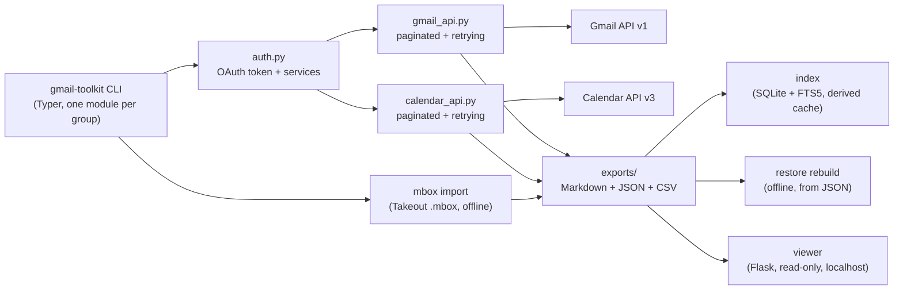

# Gmail Forensic Toolkit

[](https://github.com/enonymous1/gmail-forensic-toolkit/actions/workflows/ci.yml)
[](LICENSE)
[](pyproject.toml)

## Description

Gmail Forensic Toolkit is a command-line tool that archives a Gmail mailbox
locally as forensic Markdown reports, classifies what it archived, and
organises it with Gmail labels — with nothing uploaded anywhere. It also
exports the Gmail label inventory as JSON and Google Calendar calendars and
events as CSV, all from the same CLI.

What it does, in one line each:

- **Scrape** a mailbox for unique senders and message counts, written to
  `exports/Contact_Directory.csv`.
- **Archive** every message from a sender as a Markdown report with YAML
  frontmatter: brand, sender, date, timezone, subject, message ID, message
  type (Email / Meeting / Notification / Draft), and scope (Direct / Group /
  Broadcast), plus tracking-pixel and redirect-link counts. The raw JSON,
  HTML, and plain-text sources are cached alongside each report, so reports
  can be rebuilt offline later.
- **Organise** a sender's inbox messages under a hierarchical Gmail label,
  `Archive-Brands/<Brand>/<Sender>`, using `batchModify` — with `--dry-run`
  to see what would move first.
- **Batch-archive** senders from the contact directory, a few at a time,
  skipping a sender offset with `--skip`.
- **Digest** the last 24 hours (or `--days N`) of mailbox activity in a
  one-line-per-message table.
- **Restore** forensic Markdown from cached JSON payloads, without touching
  the Gmail API at all.
- **Labels** — export the whole label inventory. `labels inventory` writes
  the list response to `exports/labels/labels.json`; `labels details`
  writes one JSON file per label plus a joined file, with per-label counts.
  Read-only.
- **Calendar** — export Google Calendar data as CSV. `calendar calendars`
  lists every calendar, `calendar upcoming` exports the next events on one
  calendar, and `calendar events --all` exports every event of every
  calendar. Read-only (`calendar.readonly`).

<!-- VISUAL 1 — demo GIF. Capture a real terminal session (see the review's
Visual Asset Strategy) and save it as docs/assets/demo.gif, then replace
this comment with: 
Do not ship a faked or stock GIF here. -->

## Prerequisites

- Python 3.10 or newer, plus `pip` and `git`.
- A Google account with a mailbox and calendars you are allowed to export.
- A Google Cloud project with the **Gmail API** enabled. For the calendar
  commands, enable the **Google Calendar API** as well.
- An OAuth2 credential of type **Desktop application** for that project
  (see Installation). If the project's OAuth consent screen is still in
  testing mode, add your own account as a test user; Google shows an
  unverified-app warning for other accounts until the app is verified.
- No Google Workspace admin access is needed. The tool only ever touches
  the signed-in user's own mailbox and calendars.

## Installation

```bash
git clone https://github.com/enonymous1/gmail-forensic-toolkit.git
cd gmail-forensic-toolkit
python -m venv .venv
source .venv/bin/activate   # Windows PowerShell: .venv\Scripts\Activate.ps1
pip install -e .
```

This installs the `gmail-toolkit` command. `python -m gmail_toolkit` works
the same way. Check the install with:

```bash
gmail-toolkit --help
gmail-toolkit --version
```

### Gmail setup (one time)

1. In [Google Cloud Console](https://console.cloud.google.com/), create a
   project and enable the Gmail API (and the Google Calendar API if you
   want the calendar commands).
2. Create an OAuth2 credential of type **Desktop application** and download
   it as JSON.
3. Place it at `credentials/credentials.json` in the directory you run the
   CLI from. That directory is git-ignored; never commit it.
4. Run any command. A browser window opens for the first sign-in, and the
   token is saved to `credentials/token.json` (written with `0600`
   permissions on POSIX systems; on Windows, POSIX permission bits do
   not apply, so the file inherits the parent folder's ACLs instead).
   Delete that file to re-authenticate.

Override the locations with `GMAIL_CREDENTIALS_FILE` and
`GMAIL_TOKEN_FILE`. Gmail and Calendar share the one token file: a token
granted before the calendar commands existed does not carry the Calendar
scope, so delete `credentials/token.json` and sign in again the first time
you run a `calendar` command.

### Scopes

The tool requests four scopes, and a stored token only carries the scopes
granted when it was created — delete `credentials/token.json` if you change
them:

| Scope | Used for |
|---|---|
| `gmail.readonly` | Reading messages for scrape, archive, and digest |
| `gmail.labels` | Creating the `Archive-Brands/...` labels, and listing labels |
| `gmail.modify` | Removing `INBOX` when organising |
| `calendar.readonly` | Calendar commands only |

Read-only commands never modify anything. Only `organize` changes labels,
and only after you have seen its `--dry-run` output. The label and
calendar commands only read.

## Usage

Commands are grouped: `gmail-toolkit <group> <command>`. Run
`gmail-toolkit <group> --help` for every option.

```bash
# Discover senders (writes exports/Contact_Directory.csv)
gmail-toolkit scrape discovery --max-results 500

# Archive one sender (exports/<Brand>/<Sender>/)
gmail-toolkit archive contact sender@example.com --limit 100

# Import a Google Takeout .mbox file instead (same exports layout,
# offline, no Gmail API call or OAuth)
gmail-toolkit mbox import ~/Takeout/Mail/"All Mail.mbox" --limit 1000

# See what organising would do, then do it
gmail-toolkit organize labels sender@example.com --dry-run
gmail-toolkit organize labels sender@example.com

# Batch-archive the top 10 senders from the contact directory
gmail-toolkit batch process --batch-size 10 --skip 0 --limit 100

# Last 24 hours of activity (use --days N for a longer window)
gmail-toolkit digest summarize --days 1 --limit 20

# Rebuild reports from cached JSON, offline
gmail-toolkit restore rebuild exports

# Label inventory (read-only)
gmail-toolkit labels inventory
gmail-toolkit labels details

# Calendar exports (read-only; delete credentials/token.json first if your
# stored token predates the Calendar scope)
gmail-toolkit calendar calendars
gmail-toolkit calendar upcoming --max-results 10
gmail-toolkit calendar events --all

# Browse exports in a browser (read-only, localhost only)
gmail-toolkit serve
gmail-toolkit serve --exports-dir exports --port 5000

# Search index (SQLite, derived from exports/ — see below)
gmail-toolkit index build
gmail-toolkit index search budgets --brand Example
gmail-toolkit index stats
gmail-toolkit index update
```

### Where exports land

Exports always land under `./exports` in the working directory, but the
override flag differs by command:

| Command | Default output | Override |
|---|---|---|
| `scrape discovery` | `exports/Contact_Directory.csv` | `--output` |
| `archive contact`, `batch process` | `exports/<Brand>/<Sender>/` | `--exports-dir` |
| `mbox import` | `exports/<Brand>/<Sender>/` | `--exports-dir` |
| `labels inventory` | `exports/labels/labels.json` | `--output` |
| `labels details` | `exports/labels/details/` | `--output-dir` |
| `calendar calendars` | `exports/calendar/calendars.csv` | `--output` |
| `calendar upcoming` | `exports/calendar/events/<calendar-id>/events.csv` | `--output` |
| `calendar events` | `exports/calendar/events/<calendar-id>/events.csv` | `--output-dir` |
| `digest summarize` | Prints to the terminal only | — |

Two messages with the same timestamp and subject get a numeric suffix
instead of overwriting each other.

### mbox import

`gmail-toolkit mbox import <file.mbox>` is the offline counterpart to
`archive contact`: it parses a Google Takeout archive with the
standard-library `mailbox` module (streaming, so multi-gigabyte files
are never loaded wholesale) and writes the same forensic Markdown
reports into the same layout, so `gmail-toolkit serve` browses them
without knowing which source produced them. No Gmail API call, no
OAuth. Duplicates are skipped by Message-ID header, including messages
already imported by an earlier run, and messages without a Message-ID
get a deterministic `mbox-<hash>` id so re-runs dedupe them too. A
malformed message is counted and skipped, never fatal. Attachment
bytes are never extracted; only filename, type, and size are recorded
in the report. No `SourceFiles/` cache is written: the `.mbox` file
itself is the source of truth, so re-importing is the rebuild path and
`restore rebuild` does not apply to mbox imports.

### Search index (SQLite)

`gmail-toolkit index build` scans `exports/` into a SQLite database at
`exports/index.db` (override with `--db`), with an FTS5 table over
brand, sender, subject, and body. `index search <terms>` searches it
(terms are ANDed; FTS operators in the query are dropped, not
interpreted), with `--brand`, `--sender`, and `--limit` filters.
`index stats` prints totals and breakdowns: by brand, type, and
scope, top senders, tracking totals, and the date span. `index update`
refreshes the database incrementally after archiving or importing more
reports; with no database yet it is a full build.

The index is a derived cache, not a store. `exports/` remains the only
source of truth: each message row records its report's mtime and size,
and an update re-scans the directory listing and re-parses only files
that are new, changed, or gone. Deleting `index.db` is always a valid
recovery. Nothing in the toolkit writes to the database at
archive/import time, so there is exactly one writer and one reader
direction (files into database). Labels are indexed as the inventory
only — report frontmatter does not carry per-message label
membership, so the index cannot answer "messages with label X". The
viewer is not wired to the index yet; that is a later step, not part
of this release.

### Local viewer (read-only)

`gmail-toolkit serve` starts a browser view over `./exports` (or
`--exports-dir`) at `http://127.0.0.1:5000` (`--port` to change it).
Routes: home counts, `/reports` with search and brand filter, one
report rendered as HTML plus a raw-Markdown view, `/labels` for the
label inventory, and `/calendar` for calendars and exported events.

It is read-only by construction: every route is GET-only, the viewer
never imports the auth or API modules (so it cannot call Gmail or see
the OAuth token), and it only reads files already under the exports
directory — a report path that escapes that directory gets a 404. The
server binds to localhost only and there is deliberately no `--host`
flag; it uses Flask's built-in server, which is fine for a local viewer
and not a deployment target. Never put this viewer behind a public
server, and never publish real exports to a hosted site.

### Example report

Example report header, generated from a synthetic fixture message (not a
real mailbox):

```markdown
---
Brand: Example
Sender: Fictional Sender <sender@example.com>
ToolkitVersion: 2.5.0
Date: '2026-07-21 10:00:00'
Timezone: '-0400'
Subject: 'Security alert: meeting invite'
MessageID: msg-1
Type: Meeting
Scope: Direct (1:1)
---

> [!INFO] **Forensic Classification**
> - **Brand**: Example
> - **Category**: Meeting
> - **Focus**: Direct (1:1)
> - **Timezone**: -0400
> - **Tracking**: Pixels: 1, Links: 1
---
```

<!-- VISUAL 2 — rendered report screenshot. Render the fixture report above
on GitHub (or in a Markdown preview) and save a cropped screenshot as
docs/assets/report-example.png, then replace this comment with:

Capture from the synthetic fixture only — never a real mailbox. -->

## Configuration

Brand names for export folders and the label hierarchy come from a JSON
file mapping sender domains to brands:

```json
{
    "google.com": "Google",
    "microsoft.com": "Microsoft",
    "github.com": "GitHub",
    "apple.com": "Apple",
    "amazon.com": "Amazon"
}
```

Subdomains match their parent domain (`mail.google.com` → Google), and
unmapped senders fall back to `Individual`. Pass `--brands <file>` to
`archive`, `organize`, or `batch` to use a different file. When no file is
given, the built-in defaults above are used — the `config/brands.json`
file in this repository is an example copy of those defaults, not a file
the installed CLI reads automatically. A `--brands` path that does not
exist prints a warning and falls back to the built-in defaults.

## Local Development

```bash
python -m venv .venv
source .venv/bin/activate   # Windows PowerShell: .venv\Scripts\Activate.ps1
pip install -e ".[dev]"
ruff check src tests
ruff format --check src tests
mypy src
pytest -q
```

All 88 tests run offline against fake Gmail/Calendar services and synthetic
fixtures in `tests/conftest.py`; no test touches a live Google API or needs
credentials. A live Gmail/Calendar run (OAuth flow, real pagination, label
creation) is the remaining check, on your own account, after any change
that touches auth or the API wrappers. CI runs the same gates on Ubuntu
and Windows across Python 3.10–3.13.

Run any command with `--verbose` before the subcommand
(`gmail-toolkit --verbose scrape ...`) to see debug logging, including
retry warnings and HTML-conversion fallbacks. Page sizes, batch sizes,
and retry budgets live in one `Settings` dataclass
(`src/gmail_toolkit/settings.py`) that embedding callers can pass to the
API wrappers; the CLI uses its defaults.

Project layout:

```text
src/gmail_toolkit/
  auth.py            OAuth: token load/refresh/grant, Gmail + Calendar services
  gmail_api.py       Paginated, retrying, batching Gmail wrappers (messages, labels, modify)
  calendar_api.py    Paginated, retrying Calendar wrappers + CSV row shapes
  services.py        Protocols for the Gmail/Calendar service shapes
  settings.py        Page/batch/retry settings dataclass
  branding.py        Domain -> brand resolution
  paths.py           Filename sanitising, collision-safe paths, atomic writes
  process_email.py   Payload parsing + forensic Markdown generation
  mbox_parser.py     Takeout .mbox parsing (adapted from mbox-explorer)
  index_db.py        SQLite + FTS5 index derived from exports/ (a cache)
  viewer.py          Read-only Flask viewer over exports/ (no auth/API imports)
  templates/         Viewer pages (server-rendered, no external assets)
  forensics/         Classifier, header/timezone parsing, tracking scanners
  cli/               One Typer module per command group, registered in main.py
                     (serve is a top-level command, not a group)
tests/               Fake services + fixtures, one file per area under test
config/brands.json   Example brand mapping (see Configuration)
```

To add a command: add a Typer module under `src/gmail_toolkit/cli/`,
register it in `src/gmail_toolkit/cli/main.py` with `app.add_typer(...)`,
put the API calls in `gmail_api.py` or `calendar_api.py` (not in the CLI
module), and add offline tests against the fake services before opening a
pull request. Keep line length at 88 characters (ruff) and type annotations
on new public functions (mypy).

## Deployment

There is no hosted service to deploy: this is a local CLI, and the
deployed unit is an install on a machine, not a hosted service. The
viewer (`gmail-toolkit serve`) is a localhost-only process, not a
deployment target — do not expose it publicly or publish real exports
to a hosted site. The project is not published
to PyPI, so installation is always from a checkout (see Installation).

Release checklist for a maintainer:

1. Bump the version in both `src/gmail_toolkit/__init__.py` and
   `pyproject.toml` (they are duplicated by hand — keep them in sync).
2. Add a `CHANGELOG.md` entry describing what changed and what was
   deliberately left out.
3. Run the full gate: `ruff check src tests`, `ruff format --check
   src tests`, `mypy src`, `pytest -q`.
4. Verify from a fresh checkout in a fresh virtualenv, including
   `gmail-toolkit --version` and `gmail-toolkit --help`.
5. Tag the release in git only after the release commit is pushed, so the
   tag points at code that actually passed CI.
6. Never commit `credentials/` or `exports/` — both are git-ignored because
   they contain real mailbox content. Ship screenshots and diagrams made
   from synthetic fixtures only.

## How it works



- **Pagination and retries.** List calls follow every `nextPageToken`, so a
  sender with more than one page of messages is fully archived. Transient
  Gmail/Calendar errors (429 / 5xx) are retried with exponential backoff.
- **Forensic parsing.** MIME parts are walked breadth-first, the first text
  body of each type wins, duplicate headers (notably `Received`) are joined
  instead of dropped, and malformed base64 or missing dates degrade
  gracefully instead of crashing the run.
- **HTML to Markdown.** Conversion is pure Python via `markdownify` — no
  external `pandoc` binary is required, and raw HTML is never written into a
  report.
- **Classification.** Message type comes from subject keywords plus the
  Gmail `DRAFT` label; scope comes from list/bulk headers and the actual
  recipient count. Tracking detection counts 1×1 / hidden images and links
  through known redirectors.
- **Labels and Calendar.** Label listing follows every page, detail fetches
  are retried like Gmail calls and a single failed label is skipped rather
  than aborting the inventory. Calendar event listing follows every page;
  upcoming events are bounded below by the current time, and missing event
  fields degrade to empty CSV cells instead of crashing the export.

<!-- VISUAL 3 — labels terminal screenshot. Run `labels inventory` against
a throwaway account (or the fixture-based test output), crop to the table
plus the "saved to" line, save as docs/assets/labels-inventory.png, and
replace this comment with:
 -->

<!-- VISUAL 4 — calendar terminal screenshot. Run `calendar upcoming`
against a throwaway account with fictional events, crop to the event list,
save as docs/assets/calendar-upcoming.png, and replace this comment with:
 -->

## Troubleshooting

- **"Missing client secrets file"** — `credentials/credentials.json` is not
  where the CLI is running. Check the working directory, or set
  `GMAIL_CREDENTIALS_FILE` to the file's full path.
- **Calendar commands fail with 403 / accessNotConfigured** — the Google
  Calendar API is not enabled for the Cloud project. Enable it, then retry;
  no new sign-in is needed for this error.
- **Calendar commands fail with an auth/scope error after Gmail worked** —
  the stored token predates the Calendar scope. Delete
  `credentials/token.json` and sign in again.
- **A brands file change has no effect** — unless you passed `--brands
  <file>`, the built-in defaults are used (see Configuration). A
  `--brands` path that does not exist prints a warning and falls back
  to the built-ins; check the path for a typo.
- **Reports for a sender look truncated or misclassified** — check the
  cached `SourceFiles/*.json` for that message first: classification and
  tracking detection only ever see the payload, never the live mailbox.
  Rebuild offline with `restore rebuild` after a fix, instead of
  re-archiving.

## Changelog

See [CHANGELOG.md](CHANGELOG.md).

## License

MIT — see [LICENSE](LICENSE).
